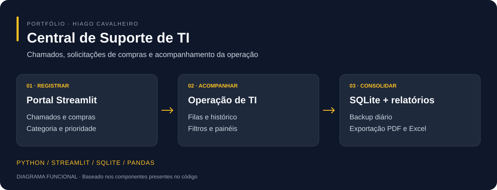

# Central de Suporte de TI

**Portal interno para organizar chamados, solicitações de compras e acompanhamento dos atendimentos.**



*Diagrama do funcionamento baseado no código; não é uma captura de tela.*

[Instalação](#instalação-local) · [Como usar](#como-usar) · [Tecnologias](#tecnologias) · [Mapa do projeto](ESTRUTURA.md)

## Funcionalidades

- Registro de chamados e solicitações de compras.
- Classificação, priorização e acompanhamento do status.
- Histórico, filtros e painéis para a operação de TI.
- Exportação de planilhas Excel e relatórios PDF.
- Persistência em SQLite e rotina de backup diário.
- Integrações opcionais de notificações por WhatsApp.

## Tecnologias

| Componente | Tecnologias |
| --- | --- |
| Aplicação | Python, Streamlit |
| Interface e personalização | HTML, CSS, JavaScript |
| Tratamento e gráficos | Pandas, Plotly, Chart.js |
| Banco | SQL, SQLite |
| Relatórios | OpenPyXL, FPDF |
| Operação Windows | PowerShell, Batch, Pythonw; VBScript legado |

## Instalação local

Requer Git e Python compatível com as dependências. No Windows:

```powershell
git clone https://github.com/hiagoac7/Portal-Suporte.git
cd Portal-Suporte
python -m venv venv
.\venv\Scripts\python.exe -m pip install streamlit pandas pillow plotly openpyxl fpdf2
```

O projeto ainda não possui uma lista de dependências com versões fixadas. Os pacotes acima foram identificados pelos imports; confirme a compatibilidade no seu ambiente.

Antes de iniciar, defina um token administrativo próprio, substituindo o valor de exemplo:

```powershell
$env:PORTAL_SUPORTE_ADMIN_TOKEN = "SUBSTITUA_POR_UM_TOKEN_FORTE"
.\venv\Scripts\python.exe -m streamlit run app/app.py --server.address 127.0.0.1 --server.port 8501
```

Se houver um token em `.streamlit/secrets.toml`, ele tem prioridade sobre a variável de ambiente. Não versione esse arquivo com valores reais.

Abra **http://127.0.0.1:8501**. O endereço acima limita o teste ao próprio computador. O script existente `LIGAR PORTAL.bat` utiliza a pasta `venv` e inicia o serviço para acesso em rede; revise a configuração antes de usá-lo.

## Como usar

1. Abra o portal e selecione a área de atendimento desejada.
2. Registre um chamado ou solicitação de compra.
3. Informe a categoria e os dados necessários ao atendimento.
4. Acompanhe a fila, o status e o histórico.
5. Consulte os painéis e exporte relatórios conforme sua necessidade.

Use dados fictícios em demonstrações. Revise a configuração de WhatsApp antes de acionar notificações, para evitar envios a contatos reais.

## Notificações opcionais

O código prevê CallMeBot por `CALLMEBOT_APIKEY` e `WHATSAPP_DESTINO` em `.streamlit/secrets.toml`. Também há um caminho alternativo com `pywhatkit`, que depende de uma sessão do WhatsApp Web. Não é necessário configurar esses serviços para apresentar a estrutura do projeto.

## Estrutura e dados

| Caminho | Conteúdo |
| --- | --- |
| `app/app.py` | Aplicação principal |
| `app/static/` | CSS, HTML e JavaScript |
| `app.py` | Compatibilidade com o caminho antigo |
| `dados/` | Banco, anexos, exportações e backups gerados no ambiente |
| `windows/` | Scripts de inicialização |
| `docs/` | Visão funcional |

Veja [ESTRUTURA.md](ESTRUTURA.md) para detalhes dos caminhos e da inicialização no Windows. Os arquivos em `documentos/` são materiais auxiliares e não são necessários para executar o portal.

## Validação

As instruções foram revisadas a partir do código e dos scripts existentes. A instalação completa, as notificações e as exportações não foram executadas nesta atualização de apresentação. Preserve cópias do banco e não publique dados reais de chamados, anexos ou credenciais.

## Outros projetos

[Inventário Windows](https://github.com/hiagoac7/inventario-ti) · [Coletor Android](https://github.com/hiagoac7/coletor-dispositivos-android) · [Sistema ATS](https://github.com/hiagoac7/rh-ats)
